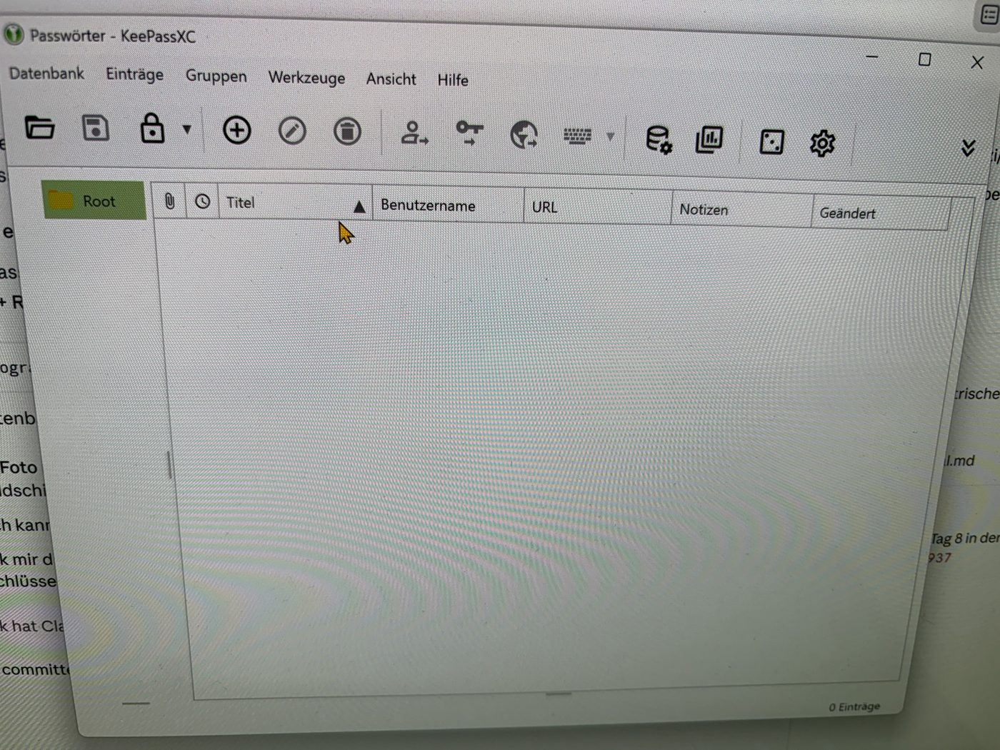
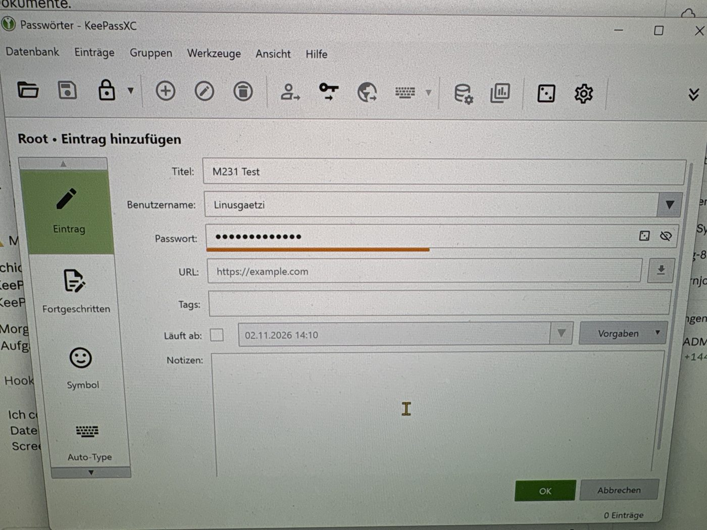
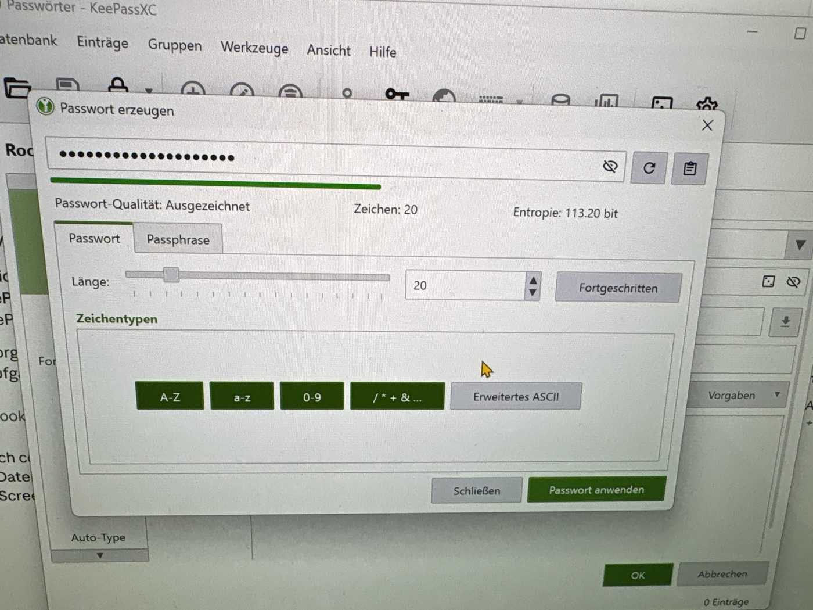

Passwortmanager

[Übersicht](../README.md)

---

## Vergleich

| Kriterium | KeePassXC | Bitwarden | 1Password |
|---|---|---|---|
| **Open Source** | Ja | Ja | Nein |
| **Preis** | Gratis | Gratis, Premium kostet | Nur kostenpflichtig (Abo) |
| **Speicherort** | Lokal (Datei) | Cloud | Cloud |
| **Konto nötig** | Nein | Ja | Ja |
| **Plattformen** | PC (Windows, macOS, Linux) | PC, Handy, Browser | PC, Handy, Browser |
| **Synchronisation** | Nur manuell über die Datei | Automatisch | Automatisch |
| **Verschlüsselung** | AES-256 / ChaCha20 | AES-256 | AES-256 |
| **Besonderes** | Blockiert Screenshots unter Windows | Gratis auf allen Geräten | Sehr einfach zu bedienen |

---

## Meine Entscheidung: KeePassXC

Ich habe mich für KeePassXC entschieden. Der wichtigste Grund ist, dass meine Passwörter nur lokal auf meinem PC gespeichert sind und nicht in einer Cloud. So muss ich keiner Firma vertrauen, dass ihre Server sicher sind. KeePassXC ist ausserdem komplett gratis und Open Source, das heisst, jeder kann den Code prüfen.

---

## Installation & Nutzung

1. KeePassXC installiert
2. Eine neue Datenbank „Passwörter“ mit einem Master-Passwort erstellt
3. Einen Eintrag „M231 Test“ angelegt
4. Mit dem Passwortgenerator ein Passwort mit 20 Zeichen erzeugt

Beim Ausprobieren ist mir aufgefallen, dass KeePassXC unter Windows **keine Screenshots** zulässt. So können Schadprogramme die Passwörter nicht einfach abfotografieren. Darum habe ich die Bilder mit dem Handy gemacht.

**1. Neue Datenbank**

**2. Eintrag hinzufügen**

**3. Passwortgenerator**

Das generierte Passwort hat 20 Zeichen, die Qualität ist „Ausgezeichnet“. So ein Passwort könnte ich mir selbst nie merken. Mit dem Passwortmanager muss ich das aber auch nicht, ich brauche nur noch das Master-Passwort.

---

## Bezug zu Handlungszielen
- **HZ 2.3 / 2.4 – Passwortmanager:** Passwortmanager verglichen, ausgewählt und eingerichtet
- **HZ 5.2 – Passwortsicherheit:** starke, zufällige Passwörter mit dem Generator

---

[Übersicht](../README.md)
