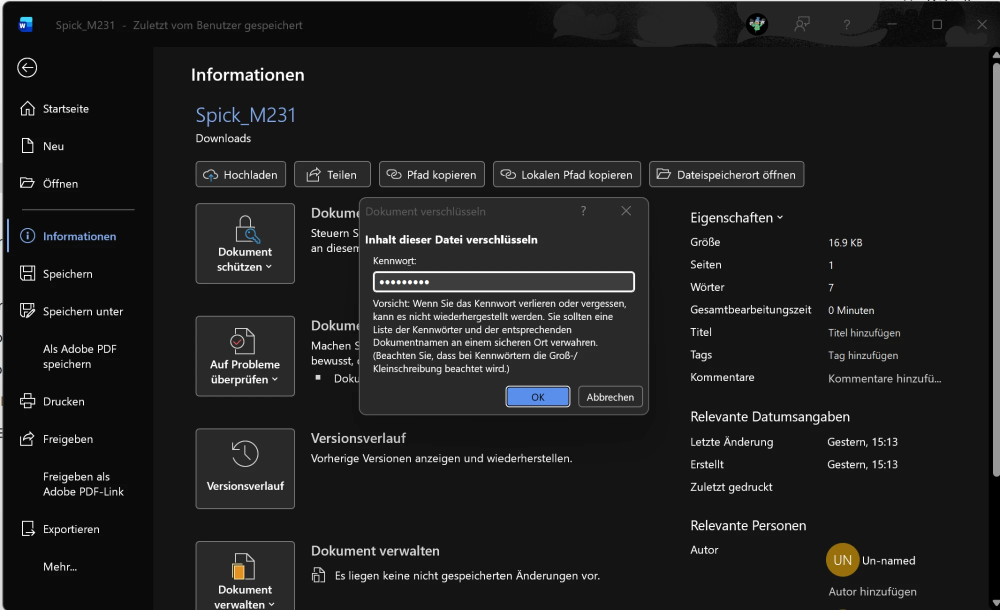
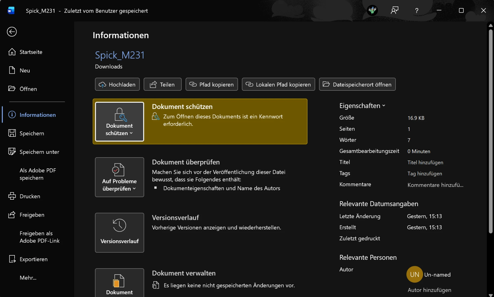

# Symmetrische Verschlüsselung in der Praxis

[Übersicht](../README.md)

---

## Verwendetes Tool

| | |
|---|---|
| **Tool** | Microsoft Word (Datei → Informationen → Dokument schützen) |
| **Verfahren** | AES-256, symmetrisch |
| **Verschlüsselte Datei** | `Spick_M231` (Word-Dokument) |

Eigentlich wollte ich 7-Zip verwenden, aber der Download hat bei mir nicht funktioniert. Word verschlüsselt Dokumente mit einem Kennwort aber ebenfalls symmetrisch mit **AES-256**. Symmetrisch heisst: Das gleiche Kennwort wird zum Verschlüsseln und zum Entschlüsseln gebraucht.

---

## Vorgehen

1. Dokument in Word geöffnet
2. **Datei** → **Informationen** → **Dokument schützen** → **Mit Kennwort verschlüsseln**
3. Kennwort eingegeben und nochmals bestätigt
4. Dokument gespeichert

Danach steht bei „Dokument schützen“: *„Zum Öffnen dieses Dokuments ist ein Kennwort erforderlich.“* Ohne das Kennwort kann man die Datei jetzt nicht mehr lesen.

---

## Screenshots

**1. Kennwort eingeben**

**2. Dokument ist geschützt**

---

## Reflexion

Ich fand es überraschend, wie einfach das geht. Man braucht dafür nicht einmal ein extra Programm. Einsetzen würde ich das bei Dateien mit persönlichen Daten, zum Beispiel bei Bewerbungsunterlagen oder Lohnabrechnungen. Im Lehrbetrieb wäre es sinnvoll, wenn ich eine Datei mit Kundendaten per E-Mail verschicken muss. Wichtig ist dann, dass ich das Kennwort über einen anderen Weg weitergebe, zum Beispiel per Telefon. Sonst bringt die Verschlüsselung nichts. Das ist genau das Schlüsselverteilungsproblem von [Tag 6](../Tage/Tag-6.md).

---

## Bezug zu Handlungszielen
- **HZ 2.1 – Verschlüsselung:** symmetrische Verschlüsselung (AES-256) praktisch angewendet

---

[Übersicht](../README.md)
