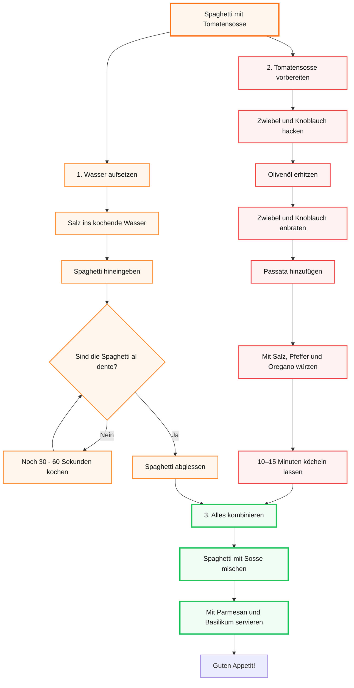

# Lernjournal

<details>
   <summary>
      Tag 1  
   </summary>

## Tag 1
---
### Was habe ich heute gemacht?
* **NotebookLM:** Wir haben uns das Tool NotebookLM angeschaut und wie man es benutzt.
* **Grundlagen Security:** Ich habe mir angeschaut, was MFA (Multi-Faktor-Authentifizierung) eigentlich ist und wo der Unterschied zwischen Authentifizierung und Autorisierung liegt.
* **Transferaufgabe (Szenario kleine Firma):**
    * **MFA-Empfehlung:** Ich würde Passwort und Badge nehmen. Jeder hat eh einen PC (für das Passwort) und einen Badge kann man jedem einfach geben. Das erfüllt dann zwei der drei Anforderungen für MFA (Wissen und Besitz).
    * **Rechte für die Buchhaltung:** Die sollten nur so viele Rechte bekommen, dass sie die Finanzen sehen können. Ändern dürfen sie aber nichts (Prinzip der minimalen Rechte).
    * **Problem bei zu vielen Rechten:** Wenn man das "Least-Privilege-Prinzip" ignoriert und ein Konto gehackt wird, hat der Angreifer sofort Zugriff auf alles. Er kann dann Daten klauen, löschen oder das ganze System manipulieren.
* **Phishing:** Wir haben besprochen, was Phishing-Angriffe sind.
---
### Was habe ich heute gelernt?
* **Der Unterschied:** Authentifizierung ist nur der Beweis, wer ich bin (Identität). Autorisierung bestimmt dann, was ich auf dem System eigentlich machen darf (Berechtigungen).
* **MFA-Faktoren:** Für eine echte Multi-Faktor-Authentifizierung braucht man mindestens zwei von drei Dingen: Wissen (z. B. Passwort), Besitz (z. B. Badge) oder Biometrie (z. B. Fingerabdruck).
* **Phishing:** Ich weiss jetzt, was der Unterschied zwischen normalem Phishing und Spearphishing (gezielte Angriffe) ist. Der Angriff auf Ubiquiti Networks im Jahr 2015. Da wurden Mitarbeiter so getäuscht, dass sie insgesamt 46,7 Millionen US-Dollar überwiesen haben.
---
### Was hat gut funktioniert?
* Die Arbeit mit **NotebookLM** hat gut funktioniert, da ich das Tool direkt kennenlernen und ausprobieren konnte.
* Die **Security-Grundlagen** konnte ich gut nachvollziehen und auf das Szenario übertragen.
* Durch das **Phishing-Beispiel** konnte ich besser verstehen, wie solche Angriffe in der Praxis funktionieren.
---
### Was würde ich anders machen und was nehme ich mir fürs nächste mal vor?
* Mehr Notizen während Unterricht machen und ich nehme mir fürs nächste mal vor alles mir gut zu merken, denn ich war heute etwas müde und deshalb konnte ich mich nicht zu 100% fokussieren.
---
</details>

<details>
   <summary>
      Tag 2
   </summary>

## Tag 2
---

### Was haben wir heute gemacht?
* Repetition Tag 1
* Git Workflow
  
<details>
       <summary>Mermaid Challenge: Spaghetti Flowchart</summary>


</details>

* Gruppenpuzzle: Datenschutzrecht im Überblick,  Expertengruppe D
---
### Was habe ich gelernt?

### Datenschutzrecht:

### 🇨🇭 revDSG → revidiertes Schweizer Datenschutzgesetz

**Grundsätze:**
- Rechtmässigkeit
- Verhältnismässigkeit
- Zweckbindung
- Richtigkeit
- Datensicherheit
- Transparenz

### Besonders schützenswerte Daten
z. B. **Gesundheit, Religion, Politik, Strafdaten, biometrische & genetische Daten**.

→ Es gelten strengere Schutzanforderungen.

### 🇪🇺 DSGVO → Datenschutz-Grundverordnung
Wichtige Rechte:
- Auskunft
- Berichtigung
- Löschung
- Datenübertragbarkeit
- Widerspruch

**DSG 🇨🇭:** Schweiz  
**DSGVO 🇪🇺:** EU/EWR, teilweise auch für Unternehmen ausserhalb der EU

### Datenpannen

<details>
   <summary>Datenpanne erkannt? Was tun.</summary>

   ```mermaid
flowchart TD
  A["Datenpanne erkannt\n(Verlust, Zugriff, Veröffentlichung\nvon Personendaten)"]
  B{"Ist die Panne\nmeldepflichtig?\n(voraussichtlich hohes Risiko\nfür Betroffene)"}
  C["Meldung an EDÖB\ninnert 72 Stunden\n(revDSG / DSGVO-Anforderung)"]
  D["Betroffene Personen\nunverzüglich informieren\n(bei hohem Risiko)"]
  E["Massnahmen ergreifen\nLücke schliessen, Schäden\nbegrenzen, Forensik"]
  F["Intern dokumentieren\nVorfall aufzeichnen,\nkeine externe Meldung nötig"]
  G["Nachkontrolle\nMassnahmen prüfen,\nWiederholung verhindern"]

  A --> B
  B -- "Ja" --> C
  C --> D
  D --> E
  E --> G
  B -- "Nein" --> F
  F --> G
```

> **EDÖB** = Eidgenössischer Datenschutz- und Öffentlichkeitsbeauftragter (www.edoeb.admin.ch)

</details>

### Merksatz
> Personendaten **rechtmässig, sparsam, zweckgebunden, korrekt, sicher und transparent** bearbeiten.
---
### Was hat gut funktioniert?
* Die Präsentationen über das Datenschutzrecht hat in unserer Gruppe sehr gut funktioniert. Allgemein dass schreiben hier ins Repo macht mir sehr Spass und man lernt dabei auch sehr viel.
---
### Was würde ich anders machen und was nehme ich mir fürs nächste mal vor?
* Ich würde eigentlich nichts anders machen ausser mich mehr in der Gruppe zu beteiligen. Ich nehme mir vor das Repo zuhause weiterzumachen. 
</details>

<details>
   <summary>
      Tag 3
   </summary>

   ## Tag 3
   ---

## Was habe ich gemacht?

Heute habe ich mich mit verschiedenen Themen rund um **Informationssicherheit, Datenschutz und Online-Anonymität** beschäftigt.

Zuerst haben wir die **CIA-Triade** kennengelernt. Dabei habe ich die drei grundlegenden Schutzziele der Informationssicherheit angeschaut:

- **Confidentiality (Vertraulichkeit)**
- **Integrity (Integrität)**
- **Availability (Verfügbarkeit)**

Danach haben wir den Unterschied zwischen **Datenschutz und Datensicherheit** behandelt. Anschliessend haben wir anhand von verschiedenen Beispielen geprüft, ob eine Situation den Datenschutz, die Datensicherheit oder beide Bereiche betrifft.

Danach haben wir konkrete Szenarien aus der Praxis analysiert. Dabei ging es unter anderem um eine Arztpraxis, einen Online-Shop und eine Schulverwaltung.

Zusätzlich habe ich mich mit dem Thema **Online-Anonymität** beschäftigt. Dabei haben wir uns angeschaut, welche Datenspuren beim Surfen entstehen und wie Technologien wie VPN und Tor funktionieren.

Zum Schluss haben wir uns mit **Datenschutz-Tools**, den Grenzen von Online-Anonymität und der Verwendung von **KI für Recherche und Faktenchecks** beschäftigt.

---

## Was habe ich gelernt?

## Die CIA-Triade

Die CIA-Triade beschreibt die drei wichtigsten Schutzziele der Informationssicherheit.

~~~mermaid
flowchart TD

    CIA["Informationssicherheit"]

    C["Confidentiality<br/>Vertraulichkeit<br/><br/>Nur befugte Personen haben<br/>Zugriff auf Daten"]

    I["Integrity<br/>Integrität<br/><br/>Daten sind korrekt<br/>und unverändert"]

    A["Availability<br/>Verfügbarkeit<br/><br/>Daten sind zugänglich,<br/>wenn sie gebraucht werden"]

    CIA --> C
    CIA --> I
    CIA --> A
~~~

| Schutzziel | Bedeutung | Beispiel für eine Verletzung |
|---|---|---|
| **Confidentiality** | Nur berechtigte Personen dürfen auf Daten zugreifen. | Ein Mitarbeiter liest Kundendaten ohne dienstlichen Grund. |
| **Integrity** | Daten sollen korrekt und unverändert sein. | Eine Rechnung wird unbemerkt verändert. |
| **Availability** | Daten und Systeme müssen bei Bedarf verfügbar sein. | Ein Server ist nach einem Angriff nicht erreichbar. |

Ich habe verstanden, dass die CIA-Triade beschreibt, **was technisch geschützt werden soll**.

Für mich ist besonders wichtig, dass die drei Ziele zusammengehören. Ein System kann beispielsweise vertraulich und korrekt sein, bringt aber trotzdem wenig, wenn die Daten nicht verfügbar sind.

---

## Datenschutz und Datensicherheit

Ein weiterer wichtiger Punkt des Tages war die Unterscheidung zwischen **Datenschutz und Datensicherheit**.

Ich habe vorher teilweise beide Begriffe gleichgesetzt. Heute wurde mir aber klar, dass sie zwar eng zusammenhängen, aber nicht dasselbe bedeuten.

~~~mermaid
flowchart LR

    DS["Datenschutz<br/><br/>Schützt Personen<br/>vor unerwünschter<br/>Bearbeitung ihrer Daten<br/><br/>Rechtlich und ethisch"]

    SI["Datensicherheit<br/><br/>Schützt Daten<br/>vor Verlust, Zerstörung<br/>und unbefugtem Zugriff<br/><br/>Technisch und organisatorisch"]

    DS -- "ergänzen sich" --- SI
~~~

| | Datenschutz | Datensicherheit |
|---|---|---|
| **Ziel** | Schutz der Persönlichkeitsrechte | Schutz von Vertraulichkeit, Integrität und Verfügbarkeit |
| **Grundlage** | Gesetze wie DSG und DSGVO | Technische und organisatorische Massnahmen |
| **Beispiel** | Personendaten nicht unerlaubt weitergeben | Verschlüsselung, Backups und Zugriffsschutz |
| **Schwerpunkt** | Personen und ihre Rechte | Daten, Systeme und Infrastruktur |

Ich habe daraus mitgenommen, dass **Datensicherheit eine wichtige Voraussetzung für Datenschutz ist**.

Wenn ein Unternehmen seine Systeme nicht ausreichend schützt, können persönliche Daten verloren gehen oder in falsche Hände geraten.

---

## Datenpannen

Ich habe gelernt, dass eine Datenpanne gleichzeitig Auswirkungen auf **Datensicherheit und Datenschutz** haben kann.

~~~mermaid
flowchart LR

    DP["Datenpanne<br/>z. B. Hackerangriff<br/>auf Kundendatenbank"]

    DSI["Datensicherheit verletzt:<br/><br/>- Vertraulichkeit gebrochen<br/>- Integrität gefährdet<br/>- Verfügbarkeit beeinträchtigt"]

    DSC["Datenschutz betroffen:<br/><br/>- Personendaten unbefugt offengelegt<br/>- Betroffene können geschädigt werden<br/>- Rechtliche Folgen möglich"]

    F["Mögliche Folgen:<br/><br/>- Meldepflicht<br/>- Reputationsschäden<br/>- Haftung<br/>- Finanzielle Folgen"]

    DP --> DSI
    DP --> DSC

    DSI --> F
    DSC --> F
~~~

Dadurch wurde mir klar, dass eine Datenpanne nicht nur ein technisches Problem ist.

Wenn beispielsweise eine Kundendatenbank gehackt wird, kann gleichzeitig:

1. die **Vertraulichkeit** verletzt werden,
2. die **Integrität** der Daten gefährdet sein,
3. die **Verfügbarkeit** beeinträchtigt werden und
4. der **Datenschutz** verletzt werden.

---

## Auskunftsbegehren

Ein weiteres Thema war das **Auskunftsbegehren**.

Ich habe gelernt, dass ich grundsätzlich von einem Unternehmen Auskunft darüber verlangen kann, **welche Personendaten über mich bearbeitet werden**.

Dabei gehören unter anderem Informationen über:

- die bearbeiteten Personendaten,
- den Zweck der Bearbeitung,
- die Herkunft der Daten,
- die Empfänger der Daten,
- die Aufbewahrung,
- mögliche Auslandsübermittlungen

dazu.

Dieses Thema fand ich besonders interessant, weil ich dabei einen direkten Bezug zu unserem Alltag herstellen konnte.

Ich habe dadurch auch verstanden, warum es wichtig ist, seine eigenen Datenschutzrechte zu kennen.

---

## Online-Anonymität

Danach haben wir uns mit der Frage beschäftigt, **welche Informationen ich beim Surfen im Internet hinterlasse**.

Ich habe gelernt, dass beim normalen Surfen verschiedene Datenspuren entstehen können.

| Datenspur | Wer kann sie sehen? |
|---|---|
| **IP-Adresse** | Webserver, Internetanbieter und unter Umständen Behörden |
| **Browser-Fingerprint** | Webseiten und Werbenetzwerke |
| **Cookies** | Webseiten und Drittanbieter |
| **DNS-Anfragen** | Internetanbieter und DNS-Provider |
| **Metadaten** | Je nach Situation verschiedene beteiligte Stellen |

Mir wurde dadurch bewusst, dass ich im Internet nicht einfach vollständig anonym bin.

Auch wenn ich keine persönlichen Informationen direkt eingebe, können durch technische Merkmale Informationen über mein Gerät und mein Verhalten entstehen.

---

## Wie funktioniert ein VPN?

Ein VPN steht für **Virtual Private Network**.

Dabei wird der Datenverkehr zwischen meinem Gerät und dem VPN-Server über eine verschlüsselte Verbindung übertragen.

~~~mermaid
sequenceDiagram

    participant U as Nutzer
    participant V as VPN-Server
    participant I as Internet / Webserver

    Note over U,V: Verschlüsselte Verbindung zwischen Nutzer und VPN-Server

    U->>V: Verschlüsselte Anfrage
    V->>I: Weiterleitung mit VPN-IP
    I-->>V: Antwort an VPN-IP
    V-->>U: Antwort an den Nutzer

    Note over U,I: Ohne VPN kann die echte IP-Adresse sichtbar sein
~~~

Ich habe dabei gelernt, dass ein VPN **keine vollständige Anonymität garantiert**.

Der VPN-Anbieter selbst kann grundsätzlich sehen, dass Datenverkehr über seinen Server läuft und je nach technischer Umsetzung auch Informationen über den Datenverkehr erhalten.

Deshalb muss ich einem VPN-Anbieter vertrauen.

Ein VPN schützt also nicht automatisch vor allen Arten von Tracking.

---

## Wie funktioniert Tor?

Auch das **Tor-Netzwerk** haben wir angeschaut.

Tor leitet meinen Datenverkehr über mehrere zufällig ausgewählte Knoten weiter. Dabei kennt nicht jeder einzelne Knoten den kompletten Weg.

~~~mermaid
flowchart LR

    U["Nutzer<br/>Tor Browser"]

    N1["Eingangsknoten<br/>Entry / Guard Node<br/><br/>kennt die echte IP<br/>des Nutzers"]

    N2["Mittlerer Knoten<br/>Middle Node<br/><br/>kennt nur<br/>Ein- und Ausgang"]

    N3["Ausgangsknoten<br/>Exit Node<br/><br/>kennt das Ziel,<br/>aber nicht direkt den Nutzer"]

    D["Ziel-Webserver<br/><br/>sieht die IP<br/>des Exit-Nodes"]

    U -- "mehrfach verschlüsselt" --> N1
    N1 -- "weitergeleitet" --> N2
    N2 -- "weitergeleitet" --> N3
    N3 -- "Verbindung zum Ziel" --> D
~~~

Ich habe gelernt, dass Tor den Datenverkehr stärker anonymisieren kann als eine normale Verbindung.

Trotzdem bedeutet Tor nicht automatisch vollständige Anonymität.

Ein wichtiger Punkt ist **HTTPS**. Wenn ich eine unverschlüsselte Verbindung verwende, kann der Exit-Node unter Umständen den Datenverkehr sehen.

Deshalb sollte ich auch bei der Verwendung von Tor auf HTTPS achten.

---


## Grenzen der Online-Anonymität

Ein wichtiger Punkt für mich waren die **Grenzen der Anonymität**.

Ich habe gelernt, dass vollständige Anonymität im Internet nur sehr schwer erreichbar ist.

Gründe dafür sind unter anderem:

- Browser-Fingerprinting
- IP-Adressen
- Cookies
- Metadaten
- eigenes Verhalten
- Logins bei persönlichen Konten
- Wiedererkennung durch mehrere technische Merkmale

Besonders wichtig fand ich die Erkenntnis, dass auch ein sehr gutes technisches Werkzeug wenig bringt, wenn ich selbst meine Identität preisgebe.

Wenn ich beispielsweise anonym surfe und mich anschliessend mit meinem persönlichen Konto anmelde, kann dieses Verhalten meine Anonymität wieder aufheben.

---

## KI und Faktencheck

Zum Schluss haben wir uns mit der Verwendung von **KI bei rechtlichen Themen** beschäftigt.

Ich habe gelernt, dass KI-Antworten zwar sehr überzeugend klingen können, aber trotzdem **inhaltlich falsch** sein können.

Gerade bei rechtlichen Fragen ist das problematisch.

Deshalb habe ich für mich folgende Regel mitgenommen:

Bei wichtigen Aussagen muss ich die Informationen gegen eine **offizielle Quelle** prüfen.

Bei Datenschutzthemen sollte ich beispielsweise direkt im Gesetz oder auf offiziellen Seiten wie der Website des **EDÖB** nachschauen.

---

## Warum ist ein Faktencheck wichtig?

Ich habe verstanden, dass bereits eine kleine falsche Information grosse Auswirkungen haben kann.

Wenn eine KI beispielsweise eine falsche gesetzliche Frist nennt, könnte ein Unternehmen im Berufsalltag eine wichtige Frist verpassen.

Deshalb sollte ich bei rechtlichen Themen immer überprüfen:

- Stimmt die genannte Frist?
- Ist der genannte Gesetzesartikel korrekt?
- Ist die zuständige Stelle richtig?
- Gilt die Regelung in der Schweiz oder in einem anderen Land?
- Ist die Information noch aktuell?

Diese Denkweise möchte ich auch bei anderen Themen anwenden.

---

## Was hat gut funktioniert?

Heute hat für mich vor allem die Kombination aus **Theorie und praktischen Beispielen** gut funktioniert.

Die CIA-Triade konnte ich durch die verschiedenen Beispiele besser verstehen. Durch die konkreten Situationen wurde mir klar, was Vertraulichkeit, Integrität und Verfügbarkeit in der Praxis bedeuten.

Auch die Gegenüberstellung von **Datenschutz und Datensicherheit** hat mir geholfen. Vorher habe ich die beiden Begriffe teilweise vermischt. Durch die Beispiele konnte ich den Unterschied deutlich besser erkennen.

Das Thema Online-Anonymität fand ich besonders interessant, weil es einen direkten Bezug zu meinem eigenen Alltag hat. Dadurch konnte ich besser verstehen, welche Informationen ich beim normalen Surfen hinterlasse.

Auch das Thema KI fand ich hilfreich, weil ich KI selbst als Werkzeug verwenden kann. Gleichzeitig habe ich verstanden, dass ich Antworten gerade bei rechtlichen Themen nicht blind übernehmen darf.

---

## Was würde ich anders machen?

Ich würde beim nächsten Mal versuchen, mich bei den Aufgaben noch genauer mit den **Begründungen** auseinanderzusetzen.

---

## Was nehme ich mir vor?

Bei meinen Aufgaben möchte ich nicht nur eine Lösung finden, sondern auch verstehen, **warum diese Lösung richtig ist**.

Für mein Repository nehme ich mir weiterhin vor, meine Arbeit regelmässig zu dokumentieren und nicht alles erst am Ende nachzutragen.

Ausserdem werde ich bei rechtlichen oder wichtigen fachlichen Aussagen aus KI-Antworten in Zukunft stärker darauf achten, diese mit einer **offiziellen Quelle zu überprüfen**.

---

# Persönliche Reflexion

Heute habe ich gemerkt, dass Informationssicherheit aus mehreren Bereichen besteht, die miteinander verbunden sind.

Am Anfang dachte ich bei Datenschutz vor allem daran, dass persönliche Daten nicht weitergegeben werden dürfen. Durch den heutigen Unterricht habe ich aber verstanden, dass es viel mehr Aspekte gibt.

Ich muss mich nicht nur fragen, **wer auf Daten zugreifen darf**, sondern auch:

> Sind die Daten korrekt?

> Sind sie verfügbar, wenn ich sie brauche?

> Werden sie nur für den vorgesehenen Zweck verwendet?

> Sind die Systeme ausreichend geschützt?

> Welche Informationen gebe ich selbst im Internet preis?

Diese Fragen helfen mir, das Thema umfassender zu betrachten.

Besonders die Unterscheidung zwischen Datenschutz und Datensicherheit nehme ich aus dem heutigen Tag mit. Ich kann jetzt besser erkennen, dass Datenschutz stärker die **Rechte und den Schutz von Personen** betrifft, während Datensicherheit stärker auf den **technischen und organisatorischen Schutz von Daten und Systemen** ausgerichtet ist.

---

</details>
</details>
