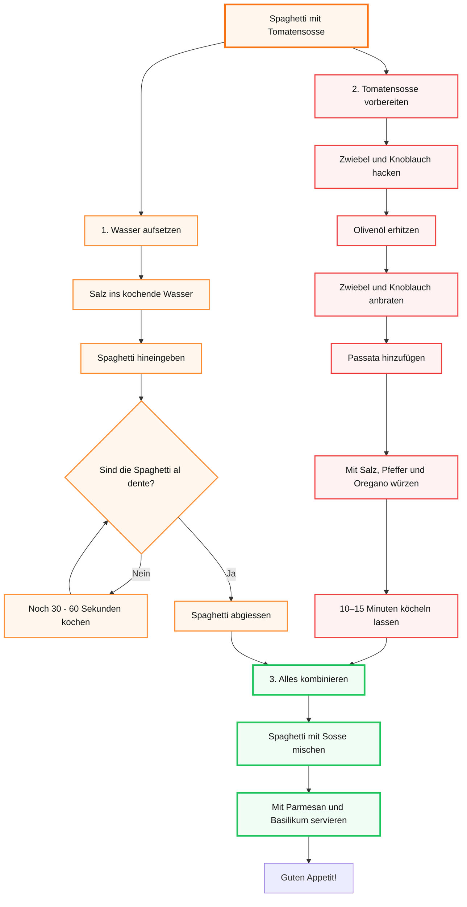

# Lernjournal

<details>
   <summary>
      Tag 1  
   </summary>

## Tag 1

### Was habe ich heute gemacht?
* **NotebookLM:** Wir haben uns das Tool NotebookLM angeschaut und wie man es benutzt.
* **Grundlagen Security:** Ich habe mir angeschaut, was MFA (Multi-Faktor-Authentifizierung) eigentlich ist und wo der Unterschied zwischen Authentifizierung und Autorisierung liegt.
* **Transferaufgabe (Szenario kleine Firma):**
    * **MFA-Empfehlung:** Ich würde Passwort und Badge nehmen. Jeder hat eh einen PC (für das Passwort) und einen Badge kann man jedem einfach geben. Das erfüllt dann zwei der drei Anforderungen für MFA (Wissen und Besitz).
    * **Rechte für die Buchhaltung:** Die sollten nur so viele Rechte bekommen, dass sie die Finanzen sehen können. Ändern dürfen sie aber nichts (Prinzip der minimalen Rechte).
    * **Problem bei zu vielen Rechten:** Wenn man das "Least-Privilege-Prinzip" ignoriert und ein Konto gehackt wird, hat der Angreifer sofort Zugriff auf alles. Er kann dann Daten klauen, löschen oder das ganze System manipulieren.
* **Phishing:** Wir haben besprochen, was Phishing-Angriffe sind.
---
### Was habe ich heute gelernt?
* **Der Unterschied:** Authentifizierung ist nur der Beweis, wer ich bin (Identität). Autorisierung bestimmt dann, was ich auf dem System eigentlich machen darf (Berechtigungen).
* **MFA-Faktoren:** Für eine echte Multi-Faktor-Authentifizierung braucht man mindestens zwei von drei Dingen: Wissen (z. B. Passwort), Besitz (z. B. Badge) oder Biometrie (z. B. Fingerabdruck).
* **Phishing:** Ich weiss jetzt, was der Unterschied zwischen normalem Phishing und Spearphishing (gezielte Angriffe) ist. Der Angriff auf Ubiquiti Networks im Jahr 2015. Da wurden Mitarbeiter so getäuscht, dass sie insgesamt 46,7 Millionen US-Dollar überwiesen haben.
---
### Was hat gut funktioniert?
* Die Arbeit mit **NotebookLM** hat gut funktioniert, da ich das Tool direkt kennenlernen und ausprobieren konnte.
* Die **Security-Grundlagen** konnte ich gut nachvollziehen und auf das Szenario übertragen.
* Durch das **Phishing-Beispiel** konnte ich besser verstehen, wie solche Angriffe in der Praxis funktionieren.
---
### Was würde ich anders machen und was nehme ich mir fürs nächste mal vor?
* Mehr Notizen während Unterricht machen und ich nehme mir fürs nächste mal vor alles mir gut zu merken, denn ich war heute etwas müde und deshalb konnte ich mich nicht zu 100% fokussieren.
---
</details>

<details>
   <summary>
      Tag 2
   </summary>

## Tag 2


### Was haben wir heute gemacht?
* Repetition Tag 1
* Git Workflow
  
<details>
       <summary>Mermaid Challenge: Spaghetti Flowchart</summary>


</details>

* Gruppenpuzzle: Datenschutzrecht im Überblick,  Expertengruppe D
---
### Was habe ich gelernt?

### Datenschutzrecht:

### 🇨🇭 revDSG → revidiertes Schweizer Datenschutzgesetz

**Grundsätze:**
- Rechtmässigkeit
- Verhältnismässigkeit
- Zweckbindung
- Richtigkeit
- Datensicherheit
- Transparenz

### Besonders schützenswerte Daten
z. B. **Gesundheit, Religion, Politik, Strafdaten, biometrische & genetische Daten**.

→ Es gelten strengere Schutzanforderungen.

### 🇪🇺 DSGVO → Datenschutz-Grundverordnung
Wichtige Rechte:
- Auskunft
- Berichtigung
- Löschung
- Datenübertragbarkeit
- Widerspruch

**DSG 🇨🇭:** Schweiz  
**DSGVO 🇪🇺:** EU/EWR, teilweise auch für Unternehmen ausserhalb der EU

### Datenpannen

<details>
   <summary>Datenpanne erkannt? Was tun.</summary>

   ```mermaid
flowchart TD
  A["Datenpanne erkannt\n(Verlust, Zugriff, Veröffentlichung\nvon Personendaten)"]
  B{"Ist die Panne\nmeldepflichtig?\n(voraussichtlich hohes Risiko\nfür Betroffene)"}
  C["Meldung an EDÖB\ninnert 72 Stunden\n(revDSG / DSGVO-Anforderung)"]
  D["Betroffene Personen\nunverzüglich informieren\n(bei hohem Risiko)"]
  E["Massnahmen ergreifen\nLücke schliessen, Schäden\nbegrenzen, Forensik"]
  F["Intern dokumentieren\nVorfall aufzeichnen,\nkeine externe Meldung nötig"]
  G["Nachkontrolle\nMassnahmen prüfen,\nWiederholung verhindern"]

  A --> B
  B -- "Ja" --> C
  C --> D
  D --> E
  E --> G
  B -- "Nein" --> F
  F --> G
```

> **EDÖB** = Eidgenössischer Datenschutz- und Öffentlichkeitsbeauftragter (www.edoeb.admin.ch)

</details>

### Merksatz
> Personendaten **rechtmässig, sparsam, zweckgebunden, korrekt, sicher und transparent** bearbeiten.
---
### Was hat gut funktioniert?
* Die Präsentationen über das Datenschutzrecht hat in unserer Gruppe sehr gut funktioniert. Allgemein dass schreiben hier ins Repo macht mir sehr Spass und man lernt dabei auch sehr viel.
---
### Was würde ich anders machen und was nehme ich mir fürs nächste mal vor?
* Ich würde eigentlich nichts anders machen ausser mich mehr in der Gruppe zu beteiligen. Ich nehme mir vor das Repo zuhause weiterzumachen. 
</details>
