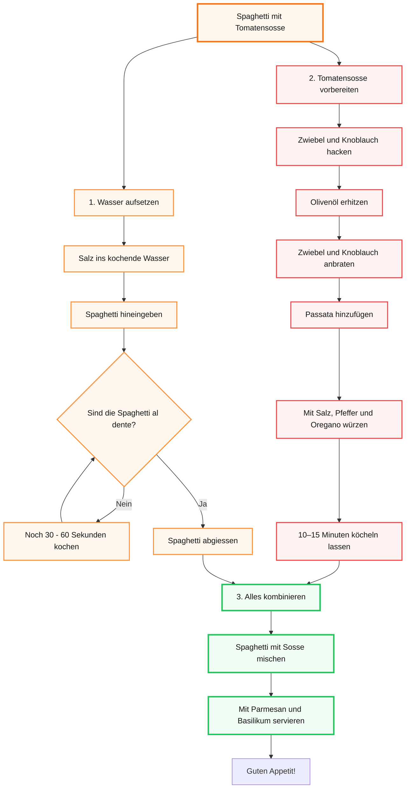

# Tag 2

[← Tag 1](Tag-1.md) · [Übersicht](../README.md) · [Tag 3 →](Tag-3.md)

---

### Was haben wir heute gemacht?
* Repetition Tag 1
* Git Workflow
  
<details>
       <summary>Mermaid Challenge: Spaghetti Flowchart</summary>


</details>

* Gruppenpuzzle: Datenschutzrecht im Überblick, Expertengruppe D
---
### Was habe ich gelernt?

### Datenschutzrecht:

### 🇨🇭 revDSG → revidiertes Schweizer Datenschutzgesetz

**Grundsätze:**
- Rechtmässigkeit
- Verhältnismässigkeit
- Zweckbindung
- Richtigkeit
- Datensicherheit
- Transparenz

### Besonders schützenswerte Daten
z. B. Gesundheit, Religion, Politik, Strafdaten, biometrische & genetische Daten.

→ Es gelten strengere Schutzanforderungen.

### 🇪🇺 DSGVO → Datenschutz-Grundverordnung
Wichtige Rechte:
- Auskunft
- Berichtigung
- Löschung
- Datenübertragbarkeit
- Widerspruch

**DSG 🇨🇭:** Schweiz  
**DSGVO 🇪🇺:** EU/EWR, teilweise auch für Unternehmen ausserhalb der EU

### Datenpannen

<details>
   <summary>Datenpanne erkannt? Was tun.</summary>

   ```mermaid
flowchart TD
  A["Datenpanne erkannt\n(Verlust, Zugriff, Veröffentlichung\nvon Personendaten)"]
  B{"Ist die Panne\nmeldepflichtig?\n(voraussichtlich hohes Risiko\nfür Betroffene)"}
  C["Meldung an EDÖB\ninnert 72 Stunden\n(revDSG / DSGVO-Anforderung)"]
  D["Betroffene Personen\nunverzüglich informieren\n(bei hohem Risiko)"]
  E["Massnahmen ergreifen\nLücke schliessen, Schäden\nbegrenzen, Forensik"]
  F["Intern dokumentieren\nVorfall aufzeichnen,\nkeine externe Meldung nötig"]
  G["Nachkontrolle\nMassnahmen prüfen,\nWiederholung verhindern"]

  A --> B
  B -- "Ja" --> C
  C --> D
  D --> E
  E --> G
  B -- "Nein" --> F
  F --> G
```

> **EDÖB** = Eidgenössischer Datenschutz- und Öffentlichkeitsbeauftragter (www.edoeb.admin.ch)

</details>

---
### Was hat gut funktioniert?
* Die Präsentationen über das Datenschutzrecht haben in unserer Gruppe sehr gut funktioniert. Allgemein macht mir das Schreiben hier im Repo sehr Spass, und man lernt dabei auch sehr viel.
---
### Was würde ich anders machen und was nehme ich mir fürs nächste Mal vor?
* Ich würde eigentlich nichts anders machen, ausser mich mehr in der Gruppe zu beteiligen. Ich nehme mir vor, am Repo zuhause weiterzuarbeiten.
---
### Bezug zu Handlungszielen
* **HZ 1.1–1.4 – Datenschutzgesetze und Betroffenenrechte:** Grundsätze des revDSG, besonders schützenswerte Daten, Rechte nach DSGVO, Vorgehen bei Datenpannen

---

[← Tag 1](Tag-1.md) · [Übersicht](../README.md) · [Tag 3 →](Tag-3.md)
