# Tag 7

[← Tag 6](Tag-6.md) · [Übersicht](../README.md) · [Tag 8 →](Tag-8.md)

---

# Verschlüsselungsverfahren

## Symmetrische Verschlüsselung
- Sender und Empfänger nutzen denselben geheimen Schlüssel zum Ver- und Entschlüsseln.
- Bob verschlüsselt den Klartext, Alice entschlüsselt den Geheimtext mit dem gleichen Schlüssel.
- **Vorteil:** schnell
- **Nachteil:** Der Schlüssel muss vorher sicher ausgetauscht werden.
- **Beispiele:** AES, DES

## Asymmetrische Verschlüsselung (Public-Key-Verfahren)
- Jede Person hat ein Schlüsselpaar: einen öffentlichen Schlüssel (Public Key) und einen privaten Schlüssel (Private Key).
- Bob verschlüsselt mit Alices Public Key, nur Alice kann mit ihrem Private Key entschlüsseln.
- **Vorteil:** kein geheimer Schlüsselaustausch nötig
- **Nachteil:** langsamer
- **Beispiele:** RSA, ECC

## Grafik

```mermaid
flowchart LR
    subgraph SYM["Symmetrisch"]
        direction LR
        B1(["Bob"]) --> P1["Klartext"]
        P1 -->|"verschlüsseln<br/>gemeinsamer Schlüssel"| C1["Geheimtext"]
        C1 -->|"entschlüsseln<br/>gleicher Schlüssel"| P2["Klartext"]
        P2 --> A1(["Alice"])
        M1(["Mallory"]) -.->|"sieht nur Geheimtext"| C1
    end

    subgraph ASYM["Asymmetrisch"]
        direction LR
        B2(["Bob"]) --> P3["Klartext"]
        P3 -->|"verschlüsseln<br/>Public Key Alice"| C2["Geheimtext"]
        C2 -->|"entschlüsseln<br/>Private Key Alice"| P4["Klartext"]
        P4 --> A2(["Alice"])
        M2(["Mallory"]) -.->|"kann ohne Private Key<br/>nicht entschlüsseln"| C2
    end
```

---

## Hashes

Ich habe in PowerShell den Befehl für den Hash eingegeben, und dann wurde der Hash der Datei ausgegeben.

Hash Screenshot

   

Beim Abändern des Dateinamens hat sich der Hash nicht geändert, weil man dafür etwas am Inhalt der Datei ändern müsste. Das ging leider nicht, weil es ein PDF ist.

---

## Bezug zu Handlungszielen
- **HZ 2.1 – Verschlüsselung:** symmetrische und asymmetrische Verschlüsselung (Public / Private Key)
- **HZ 3.1 – CIA-Prinzip:** Hashes als Schutz der Integrität

---

[← Tag 6](Tag-6.md) · [Übersicht](../README.md) · [Tag 8 →](Tag-8.md)
