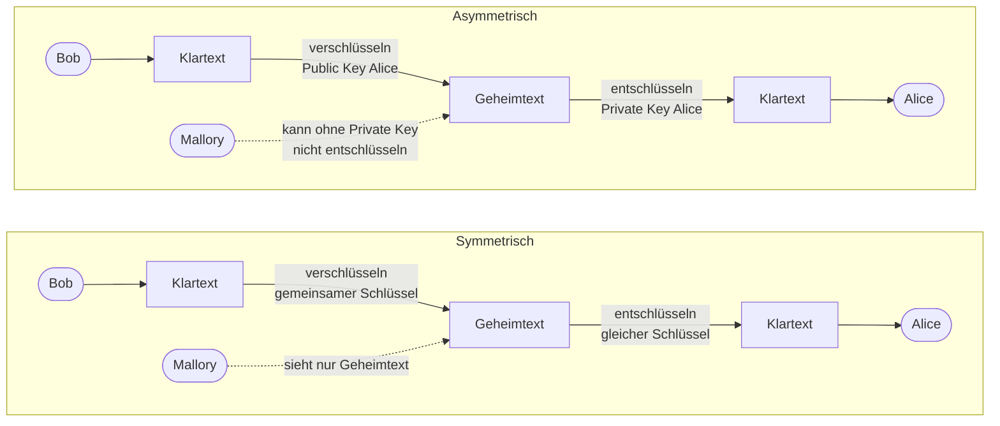

# Tag 7

[← Tag 6](Tag-6.md) · [Übersicht](../README.md) · [Tag 8 →](Tag-8.md)

---

# Verschlüsselungsverfahren

## Symmetrische Verschlüsselung
- Sender und Empfänger nutzen denselben geheimen Schlüssel zum Ver- und Entschlüsseln.
- Bob verschlüsselt den Klartext, Alice entschlüsselt den Geheimtext mit dem gleichen Schlüssel.
- **Vorteil:** schnell
- **Nachteil:** Der Schlüssel muss vorher sicher ausgetauscht werden.
- **Beispiele:** AES, DES

## Asymmetrische Verschlüsselung (Public-Key-Verfahren)
- Jede Person hat ein Schlüsselpaar: einen öffentlichen Schlüssel (Public Key) und einen privaten Schlüssel (Private Key).
- Bob verschlüsselt mit Alices Public Key, nur Alice kann mit ihrem Private Key entschlüsseln.
- **Vorteil:** kein geheimer Schlüsselaustausch nötig
- **Nachteil:** langsamer
- **Beispiele:** RSA, ECC

## Grafik



---

## Hashes

Ich habe in PowerShell den Befehl für den Hash eingegeben, und dann wurde der Hash der Datei ausgegeben.
<details>
<summary>Hash Screenshot</summary>
   

</details>
Beim Abändern des Dateinamens hat sich der Hash nicht geändert, weil man dafür etwas am Inhalt der Datei ändern müsste. Darum habe ich danach noch den Inhalt einer Kopie vom PDF geändert (siehe unten).

### Was ist ein Hash?

Ein Hash ist wie ein Fingerabdruck von einer Datei. Aus dem Inhalt wird eine Zeichenkette mit immer gleicher Länge berechnet. Gleicher Inhalt gibt immer den gleichen Hash. Schon eine kleine Änderung gibt einen komplett anderen Hash. Vom Hash kann man aber nicht auf den Inhalt zurückrechnen. Darum kann man mit Hashes prüfen, ob eine Datei verändert wurde (Integrität).

### Hashwerte als Beleg

Ich habe eine Kopie vom PDF gemacht und am Ende ein einziges Zeichen („x“) angehängt. Danach habe ich die Hashes verglichen (`Get-FileHash` rechnet standardmässig mit SHA-256):

```powershell
Get-FileHash .\Auskunftsbegehren_BeispielsBrief.pdf
Copy-Item .\Auskunftsbegehren_BeispielsBrief.pdf .\Auskunftsbegehren_BeispielsBrief_geaendert.pdf
Add-Content -Path .\Auskunftsbegehren_BeispielsBrief_geaendert.pdf -Value "x" -NoNewline
Get-FileHash .\Auskunftsbegehren_BeispielsBrief_geaendert.pdf
```

| Datei | Hashwert (SHA-256) |
|---|---|
| Original-PDF | `45D88C37A75877D8A097FA825A1676AA23DA445B2C48EE6B7A9B3017B0654417` |
| gleiches PDF, nur umbenannt | `45D88C37A75877D8A097FA825A1676AA23DA445B2C48EE6B7A9B3017B0654417` |
| [Kopie mit einem „x“ am Ende](../Hash-Test/Auskunftsbegehren_BeispielsBrief_geaendert.pdf) | `AA096B58159B7D7C59FA18116DFE934B3925E0EEF379424DF5F043B883B322A4` |

Beim Umbenennen bleibt der Hash gleich, weil der Dateiname nicht zum Inhalt gehört. Das geänderte PDF sieht genau gleich aus und lässt sich normal öffnen. Es ist nur ein einziges Byte mehr drin (189'834 statt 189'833 Bytes), trotzdem ist der Hash komplett anders. So merkt man sofort, wenn jemand eine Datei verändert hat.

---

## Bezug zu Handlungszielen
- **HZ 2.1 – Verschlüsselung:** symmetrische und asymmetrische Verschlüsselung (Public / Private Key)
- **HZ 3.1 – CIA-Prinzip:** Hashes als Schutz der Integrität

---

[← Tag 6](Tag-6.md) · [Übersicht](../README.md) · [Tag 8 →](Tag-8.md)
