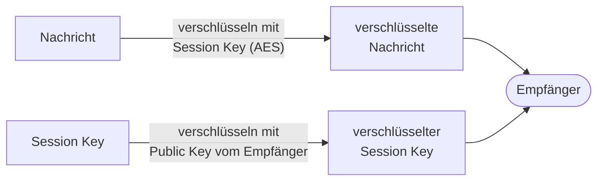

# Tag 8

[← Tag 7](Tag-7.md) · [Übersicht](../README.md)

---

## Themen des Tages
- CIA-Prinzip vertieft
- Risikomanagement und Risikoanalyse
- PGP: Hybridverschlüsselung, Signaturen und Web of Trust

---

## Was habe ich gemacht?

* Wir haben das CIA-Prinzip von Tag 3 nochmals angeschaut und mit Fallstudien vertieft. Ein Beispiel war ein Arzt, der seinen unverschlüsselten Laptop mit Patientendaten verliert.
* Wir haben eine Risikoanalyse gemacht:

   
Risikoanalysen

* Strategien: Vermeiden · Vermindern · Übertragen · Akzeptieren
* Zum Schluss haben wir angeschaut, wie PGP funktioniert.

---

## Risikoanalyse

**Risiko = Eintrittswahrscheinlichkeit × Schadensausmass**

Zuerst sammelt man, was alles schiefgehen kann. Dann schätzt man für jedes Risiko ein, wie wahrscheinlich es ist und wie gross der Schaden wäre. In der Risikomatrix sieht man dann schnell, welche Risiken man zuerst angehen muss.

| Strategie | Was heisst das? | Beispiel |
|---|---|---|
| **Vermeiden** | Man lässt das, was riskant ist, ganz weg | Kundendaten gar nicht erst in die Cloud laden |
| **Vermindern** | Man macht das Risiko kleiner | Backups, MFA, Verschlüsselung |
| **Übertragen** | Jemand anderes trägt das Risiko | Cyber-Versicherung |
| **Akzeptieren** | Man lebt bewusst damit | Kleines Risiko, Schutz wäre zu teuer |

---

## PGP

### Warum verschlüsselt PGP die Nachricht symmetrisch und nur den Schlüssel asymmetrisch?

Asymmetrische Verschlüsselung ist praktisch, weil man keinen geheimen Schlüssel austauschen muss. Sie ist aber langsam. Symmetrische Verschlüsselung wie AES ist schnell, aber man muss den Schlüssel irgendwie sicher zum Empfänger bringen.

PGP nimmt deshalb das Beste von beiden: Die Nachricht wird mit einem zufälligen Session Key (AES) verschlüsselt. Nur dieser kleine Schlüssel wird mit dem Public Key vom Empfänger verschlüsselt. So ist es schnell, und das Problem mit dem Schlüsselaustausch von Tag 6 ist trotzdem gelöst. Das nennt man **Hybridverschlüsselung**.

### Was beweist eine Signatur, was beweist sie nicht?

Eine Signatur beweist:
- dass die Nachricht wirklich vom Besitzer des Private Keys kommt (Echtheit)
- dass die Nachricht unterwegs nicht verändert wurde (Integrität), weil sonst der Hash nicht mehr stimmt

Eine Signatur beweist **nicht**:
- dass der Inhalt der Nachricht stimmt
- dass der Public Key wirklich der Person gehört, für die ich sie halte. Das muss ich selbst prüfen, z. B. mit dem Fingerprint.
- dass niemand die Nachricht gelesen hat. Eine Signatur verschlüsselt nichts.
- Wenn jemand den Private Key gestohlen hat, kann er auch in fremdem Namen signieren.

### Wo stünde mein Schlüssel im Web of Trust, und wem würde ich direkt vertrauen?

Mein Schlüssel stünde ziemlich am Rand vom Web of Trust, weil er neu ist und noch kaum jemand ihn signiert hat.

Direkt vertrauen würde ich nur Leuten, die ich persönlich kenne und bei denen ich den Fingerprint selbst verglichen habe, also z. B. der Lehrperson oder Kollegen aus der Klasse. Leuten, die ich nur über andere kenne, würde ich höchstens indirekt vertrauen.

---

## Was habe ich gelernt?
* Ein Risiko hängt immer von zwei Sachen ab: wie wahrscheinlich es ist und wie gross der Schaden wäre.
* Risikomanagement macht man nicht nur einmal. Man muss immer wieder kontrollieren, ob die Massnahmen noch wirken.
* Beim Beispiel mit dem verlorenen Laptop habe ich gesehen, dass ein einziger Vorfall gleich mehrere CIA-Ziele verletzen kann.
* PGP verbindet die symmetrische und asymmetrische Verschlüsselung von Tag 6 und 7. Für die Signaturen braucht es zusätzlich die Hashes.

## Was hat gut funktioniert / was war schwierig?
* Die Risikoanalyse hat gut funktioniert, weil wir sie an einem konkreten Beispiel gemacht haben.
* Das Web of Trust fand ich am Anfang schwierig, vor allem das indirekte Vertrauen über andere Personen.

## Was würde ich anders machen?
* Ich würde mir bei der Risikoanalyse mehr Zeit für die Begründungen nehmen, also warum ein Risiko hoch oder tief ist.

## Was nehme ich mir vor?
* Ich nehme mir vor, PGP selbst auszuprobieren und die verschlüsselte E-Mail an die Lehrperson sauber fertig zu machen.

---

## Bezug zu Handlungszielen
- **HZ 3.1 – Risiken bewerten, CIA-Prinzip:** Risikoanalyse mit Risikomatrix und Risikostrategien, CIA-Fallstudie mit dem verlorenen Laptop
- **HZ 2.1 – Verschlüsselung, PGP:** Hybridverschlüsselung, digitale Signaturen, Web of Trust

---

[← Tag 7](Tag-7.md) · [Übersicht](../README.md)
